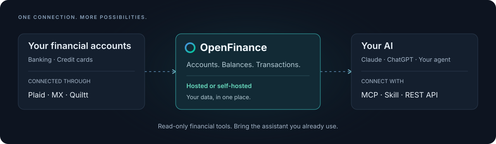

<p align="center">
  <a href="https://openfinance.sh"></a>
</p>

<h1 align="center">OpenFinance</h1>

<p align="center"><strong>Your bank accounts. Your AI. Your data.</strong></p>
<p align="center">Connect your financial accounts once. Ask about them in the AI tools you already use.</p>

<p align="center">
  <a href="https://app.openfinance.sh"><strong>Get started</strong></a> ·
  <a href="https://openfinance.sh">Website</a> ·
  <a href="#connect-your-ai">Connect your AI</a> ·
  <a href="#financial-data-providers">Providers</a> ·
  <a href="#self-host">Self-host</a> ·
  <a href="#documentation">Docs</a> ·
  <a href="CONTRIBUTING.md">Contribute</a>
</p>

<p align="center">
  <a href="https://github.com/equated-org/openfinance/actions/workflows/test.yml"></a>
  <a href="LICENSE"></a>
  <a href="docs/mcp-server.md"></a>
</p>

OpenFinance is an open-source bridge between your financial accounts and your AI.
It syncs accounts, balances, and transactions through Plaid, MX, and Quiltt,
then makes that data available through **MCP, a Skill, or the REST API**.
Use it with Claude, ChatGPT, Codex, Cursor, OpenClaw, or your own agent.

<p align="center">
  
</p>

- **Bring your own AI.** Use the same financial data across assistants and local agents.
- **Ask across accounts.** Search transactions, compare balances, and analyze spending by merchant or date.
- **Go beyond a transaction list.** Run validated, read-only SQL for totals, trends, and custom analysis.
- **Keep control of hosting.** Use the hosted app or run the app and PostgreSQL database yourself.

## Get started

1. Open [app.openfinance.sh](https://app.openfinance.sh) and sign in.
2. Connect a financial account.
3. Open the **Connect** tab and follow the instructions for your AI app.
4. Ask: **“What are my biggest recurring subscriptions?”**

You can also ask:

| Question | Data your AI can use |
| --- | --- |
| “What are my account balances?” | Connected accounts, current and available balances, currencies |
| “Which merchants did I spend the most with this quarter?” | Merchant names, amounts, dates, and SQL aggregation |
| “How has my spending changed month to month?” | Transaction history across connected accounts |
| “What large or unusual transactions happened recently?” | Transaction search, amount filters, and pending status |

Available institutions, history, and balance freshness depend on the financial data provider and your bank. Your AI interprets the data; OpenFinance supplies the account and transaction tools.

## Connect your AI

### MCP

Add this remote MCP server URL in your client's connector settings:

```text
https://api.openfinance.sh/mcp
```

Clients that support OAuth open a sign-in flow to approve access. Clients without
OAuth can use an API key from the **Connect** tab as a bearer token. The app has
per-client instructions for Claude, ChatGPT, Codex, Cursor, OpenClaw, and other clients.

For agents that can configure their own tools, use this setup prompt:

```text
Read https://api.openfinance.sh/setup.md and follow it to connect OpenFinance.
```

| MCP tool | What it does |
| --- | --- |
| `get_accounts` | List connected accounts and balances |
| `get_transactions` | Search and filter transactions |
| `query_transactions` | Run validated, read-only SQL over your transactions |
| `create_reconnect_link` | Create a link for you to reauthenticate a supported bank connection |

See the [MCP guide](docs/mcp-server.md) for authentication and local setups.
The existing [`@openfinance-sh/mcp`](https://www.npmjs.com/package/@openfinance-sh/mcp)
package remains available for clients that need a local stdio server.

### Skill and REST API

For agents without MCP, copy the Skill from the app's **Connect** tab or use the
[Skill and API reference](skill/SKILL.md). API requests use your key as a bearer token:

```sh
# Set OPENFINANCE_API_KEY to the key from your Connect tab.
curl https://api.openfinance.sh/api/accounts \
  -H "Authorization: Bearer $OPENFINANCE_API_KEY"
```

The reference includes transaction filters, SQL examples, and guidance on
currencies and transfers when calculating spending.

## How it works

1. **Connect.** Link financial accounts through a supported provider: Plaid, MX, or Quiltt.
2. **Sync.** OpenFinance stores normalized accounts, balances, and transactions in PostgreSQL.
3. **Ask.** Your AI calls OpenFinance's tools to retrieve and analyze your data.

AI access is read-only for financial data. The reconnect tool can generate a
bank sign-in link; you complete the bank authentication yourself. OpenFinance
does not expose tools to move money or make payments.

## Self-host

Requires **Node.js 22+, pnpm 10.12.4, and Docker Compose**, plus Google OAuth
credentials for sign-in and credentials for the financial providers you want to use.
Self-hosting the code does not include access to those providers. Follow the
[provider setup guide](docs/providers.md) for credentials, sandbox testing, and production access.

```sh
git clone https://github.com/equated-org/openfinance.git
cd openfinance
pnpm install
cp .env.example .env
```

Configure `.env` using the [development guide](docs/development.md), then start the database and app:

```sh
docker compose up -d db
pnpm db:migrate
pnpm dev
```

| Service | Local URL |
| --- | --- |
| Web app | <http://localhost:6100> |
| API | <http://localhost:3000> |
| MCP server | <http://localhost:3000/mcp> |
| Component Storybook | <http://localhost:6006> |

For a deployed instance, see the [Docker Compose](docs/deploy-docker-compose.md)
or [Fly.io](docs/deploy-fly.md) guide.

## Financial data providers

Self-hosters bring their own provider credentials. Start with **Plaid Sandbox**
to test the flow; add providers based on the institutions you need.

| Provider | Connection method | Self-hosting setup |
| --- | --- | --- |
| **Plaid** | Plaid Link and Transactions API | [Client ID, Sandbox / Production secrets, and institution import](docs/providers.md#plaid) |
| **MX** | MX Platform API and Connect widget | [Client ID, API key, API URL, and institution import](docs/providers.md#mx) |
| **Mastercard** | Mastercard Open Finance / Finicity through Quiltt | [Quiltt API secret, Connector ID, and Finicity configuration](docs/providers.md#mastercard-via-quiltt) |

You do not need all three to connect an account. Provider access, fees, and
production approval are separate from hosting OpenFinance. The Mastercard path
uses Quiltt's Connector and institution search; it requires Quiltt credentials.

## Security and privacy

- **Bank sign-in stays with the provider.** OpenFinance does not receive your bank login credentials.
- **AI credentials grant access to your data.** MCP uses OAuth or an API key; REST API access uses an API key. Keep tokens out of source control and public conversations.
- **Queries are scoped to you.** SQL runs against your transactions with validation, a read-only transaction, a timeout, and a result limit.
- **Choose where your data lives.** Self-hosting puts the app and database under your control. Data you send to an AI service is also subject to that service's policies.

## Documentation

| Guide | Covers |
| --- | --- |
| [Development](docs/development.md) | Local setup, configuration, and tests |
| [Provider setup](docs/providers.md) | Plaid, MX, and Mastercard via Quiltt for self-hosters |
| [MCP server](docs/mcp-server.md) | Remote MCP, authentication, and the local bridge |
| [Skill and API reference](skill/SKILL.md) | Endpoints, filters, SQL examples, and data conventions |
| [Docker Compose deployment](docs/deploy-docker-compose.md) | Running on your own server |
| [Fly.io deployment](docs/deploy-fly.md) | Deploying to Fly.io |
| [Contributing](CONTRIBUTING.md) | Reporting issues, making changes, and validation |

## Contributing

Bug reports, documentation fixes, and code contributions are welcome.
[Open an issue](https://github.com/equated-org/openfinance/issues) or read the
[contribution guide](CONTRIBUTING.md) to get started. Server tests run on pushes
and pull requests to `main` through [GitHub Actions](https://github.com/equated-org/openfinance/actions/workflows/test.yml).

Built with TypeScript, Hono, SvelteKit, Drizzle ORM, Better Auth, PostgreSQL, and DBOS.

## License

[AGPL-3.0-only](LICENSE). Contributions use the same license.
